# LLMRouter — Cost-Aware Multi-LLM Routing & Telemetry Platform

Cost-aware FastAPI gateway and React/TypeScript telemetry dashboard that predicts per-model correctness probability `P(correct | prompt, model)` to route queries across **DeepSeek V3**, **Gemini 2.5 Flash**, and **Gemini 2.5 Pro** within a pre-registered quality-retention constraint.


> *This is an independent solo project unrelated to other open-source projects or papers named "LLMRouter".*

---

## TL;DR

- **Problem:** Uniformly sending every query to **Gemini 2.5 Pro** is expensive (`66.63x` the average benchmark cost of DeepSeek V3 on the V5 Platt training split; `66.30x` on V2.1), while always using **DeepSeek V3** or **Gemini 2.5 Flash** drops MMLU-Pro accuracy by `7.67 pp` and `4.73 pp` respectively.
- **Method:** A TF-IDF + Logistic Regression quality predictor with per-model **Platt scaling** scores all three canonical models (`~4.65 ms` `p95` CPU routing latency) and picks the lowest-training-cost model meeting the quality floor (`tau = 0.85` default in `ROUTER_MODE=v5-platt`, `tau = 0.90` in `baseline`/`v21`), falling back to `gemini-2.5-pro` when no cheaper candidate qualifies.
- **Headline Result:** In leakage-free 5-fold prompt-grouped nested CV on MMLU-Pro `test_3000` (`N = 3,000`), the default V5 Platt router **retained `98.68%` of Gemini Pro accuracy, within a pre-registered `2 pp` non-inferiority margin** (`84.53%` vs. `85.67%`, lower bound `-1.70 pp > -2.00 pp`) at **`23.67%` lower offline benchmark cost**, cutting fallback from `50.77%` to `44.57%` (`-6.20 pp`) at **`4.65 ms` `p95` CPU routing latency**.
- **Caveat:** **Live-provider validation is pending / not yet run** (`BLOCKED`, no API keys in `.env`); HTTP retries, deadlines, and provider failover are **tested with mocked providers** (`httpx.MockTransport` and `MockProvider`), and cost savings reflect static offline benchmark rates rather than live billed traffic.

---

## Table of Contents

1. [The Problem](#the-problem)
2. [How It Works](#how-it-works)
3. [System Architecture](#system-architecture)
4. [Results](#results)
5. [What Did Not Work](#what-did-not-work)
6. [Evaluation Integrity](#evaluation-integrity)
7. [Dashboard](#dashboard)
8. [API](#api)
9. [Quick Start, Data Setup, and Reproduce](#quick-start-data-setup-and-reproduce)
10. [Tests](#tests)
11. [Limitations](#limitations)
12. [Repository Layout](#repository-layout)
13. [License and Acknowledgments](#license-and-acknowledgments)

---

## The Problem

Benchmark pricing across the three canonical models spans more than an order of magnitude per token, creating a sharp cost-quality tradeoff ([app/providers/model_registry.py](app/providers/model_registry.py), `GET /v1/routing/config`):

| Canonical Model ID | Display Name | Provider | Benchmark Input ($ / 1M tok) | Benchmark Output ($ / 1M tok) | Avg Cost (`v5-platt` split) | Relative Cost (`v5-platt` / `v21`) |
|---|---|---|---:|---:|---:|---:|
| `deepseek-v3-0324` | DeepSeek | `deepseek` | `$0.25` | `$0.88` | `$0.000588` | `1.00x` / `1.00x` |
| `gemini-2.5-flash` | Gemini Flash | `gemini` | `$0.30` | `$2.50` | `$0.003656` | `6.21x` / `6.16x` |
| `gemini-2.5-pro` | Gemini Pro | `gemini` | `$1.25` | `$10.00` | `$0.039206` | `66.63x` / `66.30x` |

Relative costs come directly from `RouterService.training_average_costs` in [models/router_v5_platt.joblib](models/router_v5_platt.joblib) (`2,400` MMLU-Pro prompts) and [models/router_v21_tfidf.joblib](models/router_v21_tfidf.joblib) (`2,100` MMLU-Pro prompts).

---

## How It Works

Each `/v1/chat` request scores `(prompt, model)` pairs for all three candidate models in ~`2.55 ms` `p50` / `4.65 ms` `p95`, orders eligible models above `tau` by training cost ascending (appending `gemini-2.5-pro` as a policy fallback if needed), executes with retries (`max = 2` exponential backoff + jitter on `429`/`5xx`/timeouts, `120 s` overall per-request deadline) and failover (**tested with mocked providers**), and logs privacy-safe SHA-256 prompt metadata to PostgreSQL.

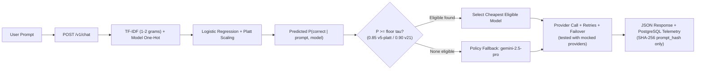

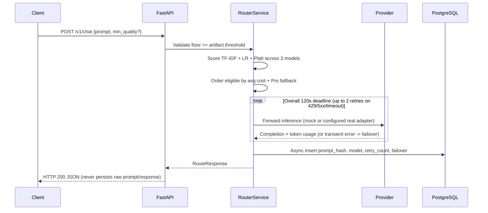

---

## System Architecture

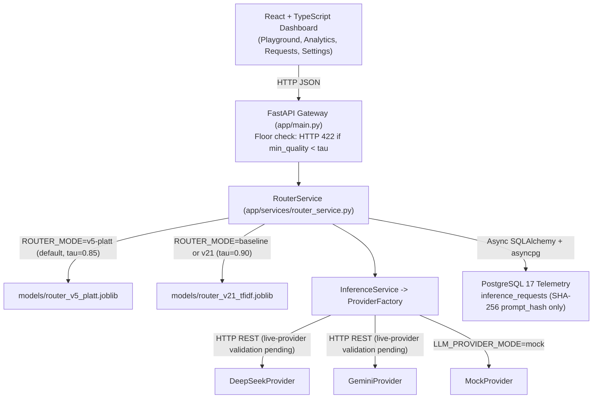

---

## Results

All models below were evaluated using leakage-free 5-fold `GroupKFold(question_id)` nested cross-validation on MMLU-Pro `test_3000` (`N = 3,000` prompts; `2,400` train / `600` test per outer fold, `tau` selected strictly on inner `80/20` splits targeting `>= 98%` of Always-Pro accuracy). Sources: [results/v5/cv_refit_v21.json](results/v5/cv_refit_v21.json), [results/v5/phase5_ab.json](results/v5/phase5_ab.json), and [results/v5/phase5_final.json](results/v5/phase5_final.json).

### Main Benchmark Comparison (`N = 3,000`, 5-Fold Nested CV)

| Method | Accuracy [95% CI] | % of Gemini Pro | Offline Cost Savings vs. Pro | Pro Fallback Rate | NI Lower Bound vs. Pro | Routing Latency `p50` / `p95` |
|---|---:|---:|---:|---:|---:|---:|
| Always DeepSeek (`deepseek-v3-0324`) | `78.00%` `[76.50%, 79.47%]` | `91.05%` | `98.50%` | — | `-9.07 pp` (FAIL) | — |
| Always Gemini Flash (`gemini-2.5-flash`) | `80.93%` `[79.50%, 82.33%]` | `94.47%` | `90.65%` | — | `-5.93 pp` (FAIL) | — |
| Always Gemini Pro (`gemini-2.5-pro`) | `85.67%` `[84.37%, 86.90%]` | `100.00%` | `0.00%` | — | `0.00 pp` | — |
| `Refit V2.1 (inner-CV tau)` [Comparator] | `84.33%` `[83.03%, 85.60%]` | `98.44%` | `21.59%` | `50.77%` | `-1.93 pp` (PASS) | `2.17` / `2.73 ms` |
| **`5a-platt` (Platt Router, Default)** | **`84.53%`** `[83.23%, 85.83%]` | **`98.68%`** | **`23.67%`** | **`44.57%`** | **`-1.70 pp`** (PASS) | `2.55` / `4.65 ms` |

- Default `5a-platt` **retained `98.68%` of Gemini Pro accuracy, within the pre-registered `2 pp` non-inferiority margin** (`-1.70 pp > -2.00 pp`), while reducing offline benchmark cost by `23.67%`.
- **Why Platt scaling helped:** Baseline 10-bin ECE was already low (`0.01769`) and Brier score stayed effectively unchanged (`0.14610` to `0.14626`). Rather than fixing severe miscalibration, per-model Platt scaling **shifts where the threshold lands**: `4` of `5` outer folds satisfy the inner `>= 98%` Pro-retention rule at `tau* = 0.85` (vs. `2` of `5` uncalibrated folds), whereas at a fixed floor of `0.90` Platt saves only `6.84%` vs. `9.83%` for fixed-`0.90` Refit V2.1 ([reports/phase5_ab.md](reports/phase5_ab.md), [reports/phase5_final.md](reports/phase5_final.md)).

### Paired Bootstrap Comparison: `5a-platt` Minus `Refit V2.1` (`10,000` Resamples, Same 5 Outer Folds)

| Metric | Point Difference | `95%` Paired Bootstrap CI | Excludes Zero? | Source |
|---|---:|---:|---|---|
| Accuracy (`pp`) | `+0.20 pp` | `[-0.37, +0.73] pp` | No (statistical parity) | [results/v5/phase5_ab.json](results/v5/phase5_ab.json) |
| Offline Benchmark Cost Savings (`pp`) | **`+2.08 pp`** | `[+0.31, +3.82] pp` | **Yes** | [results/v5/phase5_ab.json](results/v5/phase5_ab.json) |
| Pro Fallback Rate (`pp`) | **`-6.20 pp`** | `[-7.80, -4.57] pp` | **Yes** | [results/v5/phase5_ab.json](results/v5/phase5_ab.json) |

### Accuracy vs. Non-Inferiority Margin

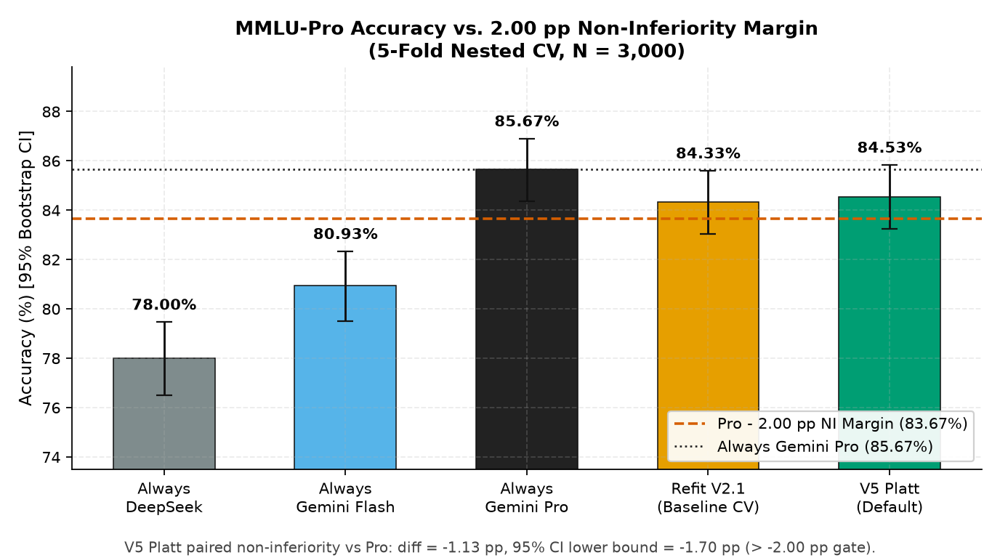

### Descriptive Cost–Quality Frontier (Floors `0.800` to `0.950`)

This frontier ([results/v5/phase5_final.json](results/v5/phase5_final.json)) evaluates fixed thresholds `0.800`–`0.950` across the 5 outer folds of `5a-platt` and is **descriptive only** (no threshold selection occurs on the outer folds):

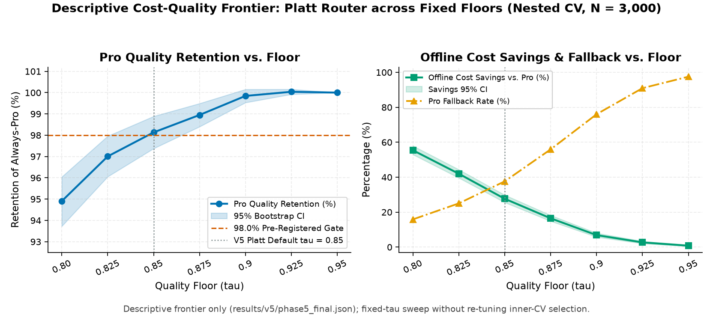

| Fixed Floor (`tau`) | Accuracy [95% CI] | % of Gemini Pro [95% CI] | Offline Cost Savings [95% CI] | Fallback [95% CI] | NI LB vs. Pro | Share DS / Fl / Pr (%) |
|---:|---:|---:|---:|---:|---:|---:|
| `0.800` | `81.30%` `[79.87, 82.67]` | `94.90%` `[93.73, 96.04]` | `55.41%` `[52.97, 57.92]` | `15.83%` `[14.53, 17.17]` | `-5.40 pp` | `39.4 / 24.0 / 36.6` |
| `0.825` | `83.10%` `[81.73, 84.43]` | `97.00%` `[96.05, 97.96]` | `41.97%` `[39.60, 44.35]` | `25.00%` `[23.43, 26.57]` | `-3.37 pp` | `23.5 / 26.1 / 50.4` |
| `0.850` | `84.07%` `[82.73, 85.33]` | `98.13%` `[97.37, 98.89]` | `27.64%` `[25.55, 29.80]` | `37.60%` `[35.87, 39.33]` | `-2.27 pp` | `11.1 / 22.5 / 66.4` |
| `0.875` | `84.77%` `[83.47, 86.03]` | `98.95%` `[98.40, 99.49]` | `16.46%` `[14.84, 18.18]` | `55.90%` `[54.13, 57.67]` | `-1.37 pp` | `4.9 / 15.5 / 79.6` |
| `0.900` | `85.53%` `[84.27, 86.77]` | `99.84%` `[99.53, 100.15]` | `6.84%` `[5.77, 8.00]` | `76.00%` `[74.43, 77.50]` | `-0.40 pp` | `1.7 / 7.2 / 91.0` |
| `0.925` | `85.70%` `[84.43, 86.93]` | `100.04%` `[99.92, 100.16]` | `2.67%` `[2.03, 3.36]` | `90.93%` `[89.87, 91.93]` | `-0.07 pp` | `0.5 / 3.2 / 96.3` |
| `0.950` | `85.67%` `[84.40, 86.90]` | `100.00%` `[100.00, 100.00]` | `0.79%` `[0.47, 1.16]` | `97.50%` `[96.93, 98.07]` | `0.00 pp` | `0.0 / 0.9 / 99.1` |

### Routing Share and Fallback Reduction

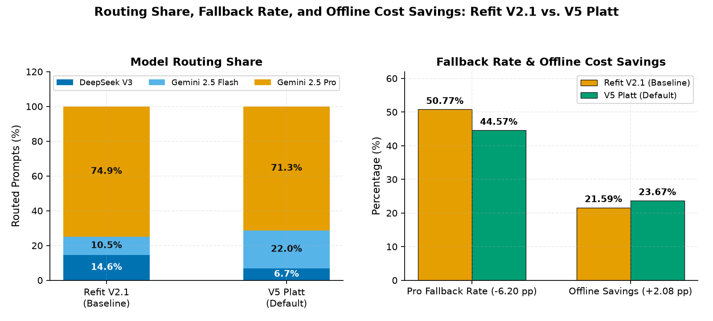

### CPU Routing Decision Latency vs. 25 ms Budget

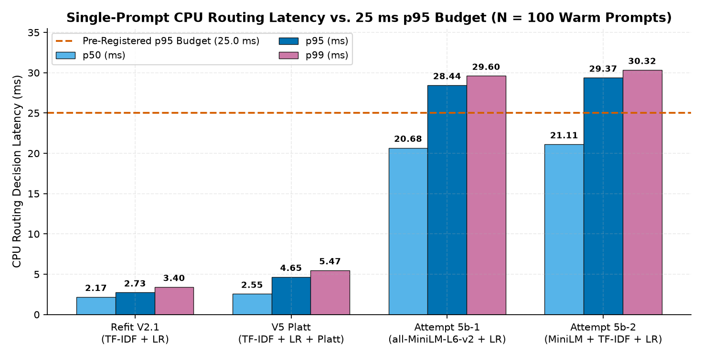

Cold-start process measurements ([results/v5/phase5_ab.json](results/v5/phase5_ab.json), [results/v5/phase5_final.json](results/v5/phase5_final.json)): TF-IDF + LR cold start is `108.53 ms`, compared with `5,939.29 ms` cached (`32,410.98 ms` uncached download + load) for `all-MiniLM-L6-v2`.

---

## What Did Not Work

Only **`1` of `6` attempts passed its pre-registered gate** in [results/v5/attempt_log.csv](results/v5/attempt_log.csv). Dense embeddings (`5b-minilm`, `5b-minilm-tfidf`) and subject/prompt-metadata features (`5c-subject-meta`) were evaluated and documented as **failed attempts**:

| Attempt | Accuracy | % of Pro | Offline Savings | Fallback Rate | `p95` Latency | Pre-Registered Gate | Failure Reason |
|---|---:|---:|---:|---:|---:|---|---|
| `comparator` (`Refit V2.1`) | `84.33%` | `98.44%` | `21.59%` | `50.77%` | `2.73 ms` | Baseline Comparator | Reference threshold |
| **`5a-platt`** (Platt scaling) | **`84.53%`** | **`98.68%`** | **`23.67%`** | **`44.57%`** | **`4.65 ms`** | **PASS** | — |
| `5a-isotonic` (Isotonic) | `84.70%` | `98.87%` | `19.79%` | `43.70%` | `4.54 ms` | FAIL | Savings `19.79% < 21.59%`; Brier `0.15091` |
| `5b-minilm` (`all-MiniLM-L6-v2` + LR) *(failed attempt)* | `84.60%` | `98.75%` | `14.76%` | `65.10%` | `28.44 ms` | FAIL | Violated `<= 25 ms` `p95` gate & lower savings (`14.76%`) |
| `5b-minilm-tfidf` (MiniLM + TF-IDF + LR) *(failed attempt)* | `84.13%` | `98.21%` | `17.14%` | `61.90%` | `29.37 ms` | FAIL | Violated `<= 25 ms` `p95`, NI LB `-2.10 pp`, & lower savings |
| `5c-subject-meta` *(failed attempt; requires subject label at inference)* | `83.83%` | `97.86%` | `25.55%` | `48.37%` | `24.73 ms` | FAIL | Retention `97.86% < 98%`, NI LB `-2.50 pp` |

*(Because `5b-minilm` already exceeded `25 ms` `p95` CPU latency and raised fallback to `65.10%`, GBT-on-embeddings was skipped.)*

### Cross-Domain Transfer Failures (GPQA & LiveCodeBench)

Leave-One-Dataset-Out (LODO) evaluation ([results/v5/cross_domain.json](results/v5/cross_domain.json), [reports/phase4_cross_domain.md](reports/phase4_cross_domain.md)) shows that a global threshold calibrated on MCQ benchmarks does not transfer zero-shot to coding (`LiveCodeBench`, `N = 1,055`) or PhD-level science (`GPQA`, `N = 198`, wide CIs):

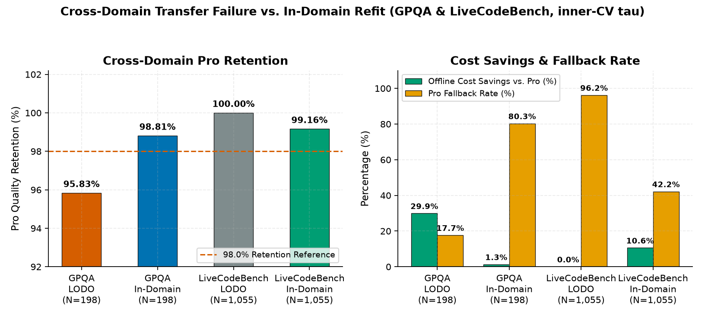

- **GPQA (`N = 198`):** LODO Text-Only (`inner-CV tau`) dropped accuracy from `84.85%` (Always-Pro) to `81.31%` (`95.83%` retention, NI LB `-7.58 pp`), while an in-domain 5-fold refit restored `98.81%` retention at `1.31%` savings (`80.30%` fallback).
- **LiveCodeBench (`N = 1,055`):** `DeepSeek V3` reaches `66.64%` vs. `60.00%` for `Gemini 2.5 Flash` (reversing their `78.00%` vs. `80.93%` MMLU-Pro ordering), and Always-Pro itself scores `79.15%` — below a `0.90` floor — so LODO Text-Only hits `96.21%` fallback and `100.0%` routing to Pro (`0.00%` savings). An in-domain refit lowers `tau*` (`0.80–0.85`), shifts `15.45%` of queries to DeepSeek, retains `99.16%` of Pro accuracy (`78.48%` vs. `79.15%`, NI LB `-1.42 pp`), and saves `10.59%`.

---

## Evaluation Integrity

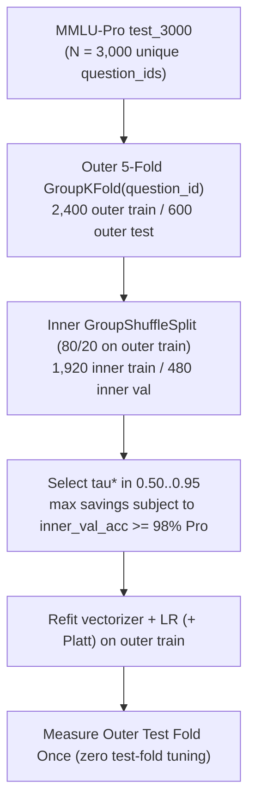

- **Pre-registered gates:** All Phase 1–5 hypotheses, metrics, comparators, `-2.00 pp` NI margin, `>= 98%` Pro retention target, and `<= 25 ms` `p95` routing latency gate are documented in [reports/pregistered_gates.md](reports/pregistered_gates.md).
- **Burned 450 test split quarantined:** The legacy 450-prompt MMLU-Pro split used across earlier V2/V2.1/V2.2 evaluations is excluded from Phase 1 CV refits, Phase 3 non-test probe sampling, and Phase 5 training ([scripts/live_validation.py](scripts/live_validation.py)).
- **`99.8%` (`998/1,000`) / `99.7%` (`998/1,001`) prompt overlap quarantine:** `data/llmrouter_mmlupro_long.csv` (`1,001` question IDs / `1,000` unique prompt texts) shares `998` prompt texts with `data/llmrouter_mmlupro_test3000_long.csv` and was excluded from Phase 4 cross-domain experiments ([reports/phase4_cross_domain.md](reports/phase4_cross_domain.md)).
- **In-sample CV contamination fix:** An earlier evaluation scored the static `models/router_v21_tfidf.joblib` checkpoint on all `3,000` prompts where `2,100 / 3,000` (`70%`) were in its training set, inflating apparent retention to `99.96%` (`10.31%` savings). Re-running true outer-fold refits in Phase 1 yielded unbiased out-of-sample metrics (`98.44%` retention, `21.59%` savings, `50.77%` fallback).

---

## Dashboard

Screenshots below were captured at `1400 px` viewport width against a running FastAPI backend in `MockProvider` mode (`ROUTER_MODE=v5-platt`, `tau = 0.85`):

| Playground (active `MockProvider` route + candidate probabilities) | Settings (active policy, benchmark cost table, privacy guarantees) |
|---|---|
| 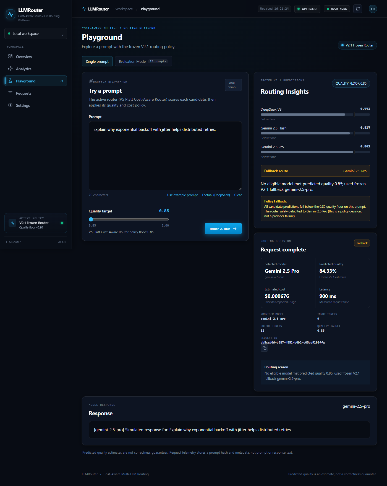 | 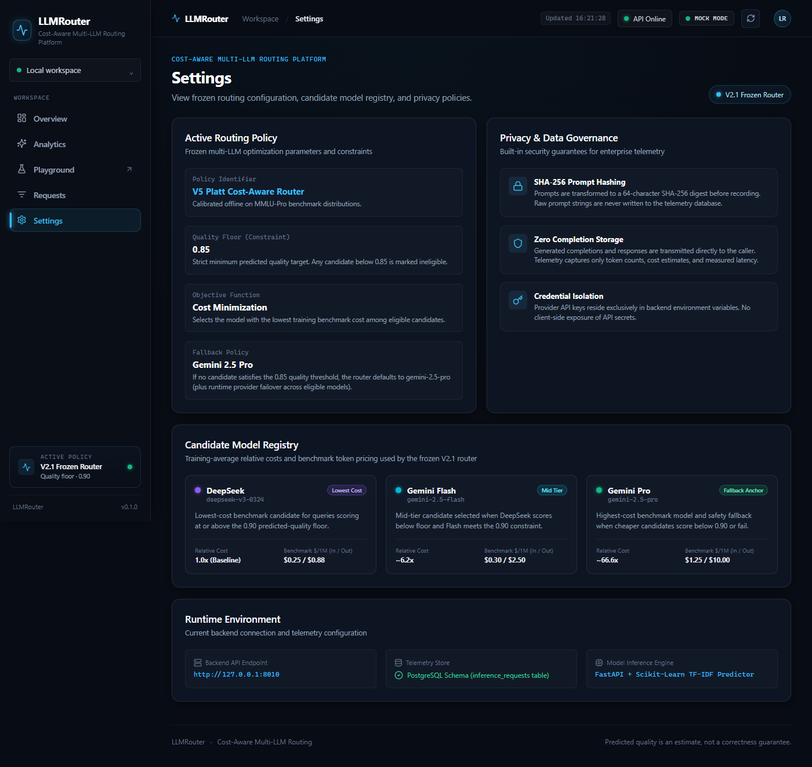 |

> **Note on Telemetry Pages (`Analytics` and `Requests`):** Because no initialized PostgreSQL `inference_requests` instance was populated during this local capture, `Analytics` and `Requests` screenshots are intentionally omitted rather than showing empty database errors.
>
> <!-- TODO: Capture docs/images/dashboard-analytics.png and docs/images/dashboard-requests.png after running compose.yaml postgres + scripts/init_telemetry_db.py + seeded mock /v1/chat requests. -->

---

## API

Endpoints implemented in [app/main.py](app/main.py):

| Method | Path | Purpose |
|---|---|---|
| `GET` | `/health` | Service liveness probe returning `{"status": "ok", "service": "llmrouter"}`. |
| `GET` | `/v1/runtime` | Reports active provider mode (`mock`, `real`, or `unknown`). |
| `GET` | `/v1/routing/config` | Returns active policy ID, validated `quality_floor`, fallback model, telemetry table, and candidate benchmark prices/ratios. |
| `POST` | `/v1/route/explain` | Scores candidate `P(correct | prompt, model)` without provider execution or telemetry persistence (`422` if `min_quality < active_floor`). |
| `POST` | `/v1/chat` | Routes a prompt, executes completion with retries/failover/120s deadline, records privacy-safe telemetry, and returns `RouteResponse` (`POST /v1/route` is a hidden compatibility alias). |
| `GET` | `/v1/analytics/summary` | Returns aggregate request count, mean cost/latency, error rate, `fallback_rate`, and `failover_rate` from PostgreSQL (`503` if DB uninitialized). |
| `GET` | `/v1/analytics/models` | Returns per-model request count, average/total cost, mean latency, and average predicted quality from PostgreSQL. |
| `GET` | `/v1/analytics/recent` | Returns the latest `8` `InferenceRequestRecord` metadata rows (`prompt_hash` only). |
| `GET` | `/v1/requests` | Paginated, filterable telemetry history (`limit`, `offset`, `model`, `status`, `search`). |

### Example Request and Real `MockProvider` Response

```bash
curl -s -X POST "http://127.0.0.1:8000/v1/chat" \
  -H "Content-Type: application/json" \
  -d '{"prompt": "Explain binary search vs linear search in two sentences."}'
```

Captured JSON response from a running `MockProvider` session (`ROUTER_MODE=v5-platt`):

```json
{
  "request_id": "6b0fc3ae-a731-4058-95ed-3fa8ca62fe2d",
  "selected_model": "gemini-2.5-pro",
  "canonical_model": "gemini-2.5-pro",
  "predicted_quality": 0.8606250858391076,
  "routing_reason": "Selected the lowest training-cost model with predicted quality at least 0.85 under the frozen V2.1 policy.",
  "response": "[gemini-2.5-pro] Simulated response for: Explain binary search vs linear search in two sentences.",
  "input_tokens": 9,
  "output_tokens": 32,
  "latency_ms": 900.0,
  "estimated_cost_usd": 0.000676,
  "provider_model": "gemini-2.5-pro",
  "model_mapping_warning": null,
  "attempted_models": [
    "gemini-2.5-pro"
  ],
  "failover": false,
  "policy_fallback": false,
  "retry_count": 0
}
```

---

## Quick Start, Data Setup, and Reproduce

### Quick Start

```powershell
# 1. Start FastAPI backend in MockProvider mode (default ROUTER_MODE=v5-platt, tau=0.85;
#    set ROUTER_MODE=baseline or v21 for legacy tau=0.90)
$env:LLM_PROVIDER_MODE = "mock"
$env:ROUTER_MODE = "v5-platt"
.\.venv\Scripts\python.exe -m uvicorn app.main:app --reload --port 8000

# 2. Start React/TypeScript dashboard (in a second terminal)
cd frontend
$env:VITE_API_URL = "http://127.0.0.1:8000"
npm.cmd run dev
```

Optional PostgreSQL 17 telemetry (`compose.yaml`):

```powershell
# Start PostgreSQL matching compose.yaml, set DATABASE_URL in environment or .env, then run:
.\.venv\Scripts\python.exe scripts/init_telemetry_db.py
.\.venv\Scripts\python.exe scripts/smoke_telemetry_postgres.py
```

### Data Setup

- **Committed Data:** [data/llmrouter_mmlupro_test3000_long.csv](data/llmrouter_mmlupro_test3000_long.csv) (MMLU-Pro `test_3000`, `N = 3,000` prompts / `9,000` rows; MIT License) and [data/router_v21_split_report.json](data/router_v21_split_report.json) are committed in the repository. Phase 1, Phase 3 `--mode probe`, Phase 5, `train_router_v5_platt.py`, and figure generation run standalone without downloading external files.
- **External Benchmarks (Not Included in Git):**
  - **GPQA (`N = 198` prompts):** Gated upstream on HuggingFace (`idavidrein/gpqa`, CC BY 4.0). **GPQA examples must not be posted publicly in plain text or images**, per the dataset maintainers' anti-contamination request.
  - **LiveCodeBench (`N = 1,055` prompts):** Upstream at `livecodebench/code_generation` (`code_generation_lite`, HuggingFace / `LiveCodeBench/LiveCodeBench`).
  - Both `data/llmrouter_gpqa_long.csv` and `data/llmrouter_livecodebench_long.csv` are listed in [.gitignore](.gitignore). To rebuild them locally after downloading per-model raw JSON outputs into `D:\Downloads\bench-release` (matching `BENCH_ROOT` in [scripts/build_external_datasets.py](scripts/build_external_datasets.py)):

```powershell
.\.venv\Scripts\python.exe scripts/build_external_datasets.py
.\.venv\Scripts\python.exe scripts/check_phase5_data_integrity.py
```

### Reproduce

All standalone commands below were executed and verified (`exit code 0`):

| Step | Command | Measured Runtime |
|---|---|---|
| Regenerate README PNG figures | `.\.venv\Scripts\python.exe scripts/make_readme_figures.py` | `1.78 s` |
| Phase 3 safe `.env` probe (no keys printed) | `.\.venv\Scripts\python.exe scripts/live_validation.py --mode probe` | `3.02 s` |
| Phase 1 leakage-free 5-fold CV refit | `.\.venv\Scripts\python.exe scripts/run_v5_phase1_cv_refit.py` | `123.43 s` |
| Phase 5 paired bootstrap + `phase5_ab` summary (`--update-paired-only`) | `.\.venv\Scripts\python.exe scripts/run_v5_phase5_ab.py --update-paired-only` | `108.86 s` |
| Phase 5 metadata ablation, frontier, & in-process concurrency | `.\.venv\Scripts\python.exe scripts/run_v5_phase5_cd.py` | `272.86 s` |
| Fit default `models/router_v5_platt.joblib` artifact | `.\.venv\Scripts\python.exe scripts/train_router_v5_platt.py` | `13.30 s` |
| Phase 4 cross-domain LODO + in-domain refit | `.\.venv\Scripts\python.exe scripts/run_v5_phase4_cross_domain.py` | *Requires local GPQA & LiveCodeBench CSVs above* |

---

## Tests

Measured directly on the current `public-main` tree:

```powershell
.\.venv\Scripts\python.exe -m pytest -q
# 133 passed, 3 skipped (136 collected —
# the 3 tests in tests/test_v5_phase4_cross_domain.py skip cleanly when GPQA/LiveCodeBench CSVs are absent)

cd frontend
npm.cmd test -- --run
# 1 passed file, 10 passed tests (src/test/App.test.tsx)
npm.cmd run build
# tsc -b && vite build succeeded (dist/assets/index-DwnfI3Z0.js 482.15 kB)
```

---

## Limitations

- **Live-provider validation is pending / not yet run (`BLOCKED`, no API keys in `.env`):** Real provider latency, billed cost, and live correctness on MMLU-Pro have not been measured end-to-end.
- **Mocked reliability coverage:** Retries, the `120 s` deadline, and failover are **tested with mocked providers** (`httpx.MockTransport` and `MockProvider`), not real provider outages.
- **Offline benchmark cost model:** Savings use historical token lengths and fixed per-1M-token benchmark rates (`$0.25/$0.88`, `$0.30/$2.50`, `$1.25/$10.00`).
- **Domain scope:** Training and Platt calibration use MMLU-Pro multiple-choice questions only; zero-shot cross-domain transfer failed on LiveCodeBench (`0.00%` savings) and degraded GPQA accuracy (`95.83%` retention).
- **Gateway scope:** No token streaming (SSE), user authentication, or API rate-limiting middleware is implemented.
- **Model snapshot drift:** Benchmarked snapshots (`deepseek-v3-0324`, `gemini-2.5-flash`, `gemini-2.5-pro`) may differ from current upstream model endpoints.
- **In-process concurrency benchmark:** Reported throughput (`201.3 req/s` at `c = 1`, `179.9 req/s` at `c = 10`, `198.4 req/s` at `c = 50` for `500` requests/level in [results/v5/phase5_final.json](results/v5/phase5_final.json)) was measured in-process via `ASGITransport` with mocked providers on a single event loop. At `c = 50`, `p95 = 234.46 ms` measures single-worker event-loop **queueing delay** over synchronous scikit-learn calls, not routing decision time (`4.65 ms` `p95`) or network I/O.

---

## Repository Layout

Generated from the tracked `git ls-files` tree (`121` tracked files across source, configs, datasets, runtime artifacts, figures, reports, and tests):

```text
.
├── .env.example
├── .gitignore
├── compose.yaml                                # Local PostgreSQL 17 service definition
├── pyproject.toml
├── app/
│   ├── main.py                                 # FastAPI endpoints & exception handlers
│   ├── config.py                               # Settings (ROUTER_MODE default: v5-platt)
│   ├── schemas.py                              # Pydantic request/response schemas
│   ├── providers/                              # DeepSeek, Gemini, Mock adapters + HTTP retry/pricing
│   ├── services/                               # RouterService, InferenceService, cost-aware policy
│   └── telemetry/                              # Async PostgreSQL repository & API schemas
├── data/
│   ├── llmrouter_mmlupro_test3000_long.csv     # Committed N=3,000 MMLU-Pro benchmark split
│   ├── router_v21_split_report.json            # Quarantined split IDs & integrity metadata
│   └── ...                                     # SHA-pinned V2.1/V2.2 integrity records & dataset JSON reports
├── docs/images/                                # Reproducible matplotlib charts & dashboard screenshots
├── frontend/                                   # Vite + React + TypeScript dashboard & Vitest suite
├── models/
│   ├── router_v5_platt.joblib                  # Default V5 Platt artifact (tau = 0.85)
│   └── router_v21_tfidf.joblib                 # Selectable frozen V2.1 artifact (tau = 0.90)
├── reports/                                    # Phase 1-5 reports, pregistered_gates.md, FINAL_RESUME_EVIDENCE.md
├── results/
│   ├── experiments/                            # Prior Phase 5 reference JSON/CSV outputs
│   └── v5/                                     # Primary Phase 1-5 evaluation JSON/CSV artifacts
├── scripts/                                    # CV refits, live probe, figure generator, data builders, DB CLI
└── tests/                                      # Pytest backend reliability, router, telemetry, & V5 test suites
```

---

## License and Acknowledgments

- **License:** License TBD (add a repository `LICENSE` file before public redistribution).
- **Upstream Benchmark Datasets:**
  - **MMLU-Pro** (`TIGER-AI-Lab/MMLU-Pro`): MIT License.
  - **GPQA** (`idavidrein/gpqa`): CC BY 4.0 (gated upstream; raw benchmark questions are excluded from this repository per dataset maintainers' anti-contamination request).
  - **LiveCodeBench** (`livecodebench/code_generation`): MIT evaluation code / Creative Commons dataset (excluded from git; rebuilt locally via [scripts/build_external_datasets.py](scripts/build_external_datasets.py)).
